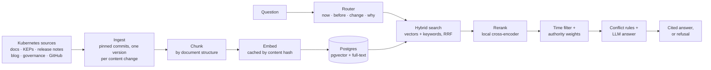

# Organizational Knowledge & Decision Intelligence RAG

[](https://github.com/JasonServito/org-knowledge-rag/actions/workflows/ci.yml)

A retrieval-augmented generation (RAG) system that treats **time, source authority and conflicting information** as data, instead of leaving them for the LLM to guess at.

It runs on the public Kubernetes project: about 1,170 documents (docs pages, KEPs, release notes, blog posts, governance docs) across 18 releases, 1.20 to 1.37. It answers four kinds of question, each with citations:

- what's true **now**
- what was true **before**
- **how** something changed
- **why** it changed

It refuses when the public record doesn't contain the answer.

## Why this is harder than "chat with your docs"

Organizational knowledge changes over time. Sources differ in authority, and documents contradict each other. For example, a KEP's metadata can claim a feature is stable while the feature-gate reference still says beta. A plain RAG pipeline mixes all of that into one answer.

This project stores every version of every document with the releases it was valid in, gives each source a trust tier, detects conflicts before answering, and measures each retrieval technique against a fixed golden set.

## How it works



- **Versions and validity:** each document version records the releases it was valid in, so "back then" questions search the text of that time ([ADR-002](docs/decisions/ADR-002-versioning-and-identity.md)).
- **Hybrid search:** vector similarity and Postgres full-text search, merged with Reciprocal Rank Fusion (RRF), a rank-based way to combine two result lists.
- **Rerank:** a cross-encoder (`BAAI/bge-reranker-base`, on CPU) reads the question next to each candidate and rescores it ([ADR-008](docs/decisions/ADR-008-reranker.md)).
- **Time and authority:** a router sorts the question into now / before / change / why; "now" questions drop replaced text, and each question kind boosts the sources it trusts ([ADR-003](docs/decisions/ADR-003-authority-and-status.md), [ADR-009](docs/decisions/ADR-009-query-mode-routing.md)).
- **Conflicts:** code rules check stored facts (a KEP's claimed stage against the feature-gate reference); the model adds pairs of texts that disagree; code settles each by validity, then by tier ([ADR-010](docs/decisions/ADR-010-conflict-detection.md)).
- **Answer:** structured output with citations; a citation to anything not retrieved turns the answer into a refusal.

## Results: before and after

Each stage was kept only if it passed an improvement rule fixed before its paid eval: its target metric up by ≥ 0.03, no other retrieval metric down by more than 0.03, and the answer checks no worse ([product spec](docs/product-spec.md)).

The golden set has 43 questions: 36 answerable and 7 that should be refused. An LLM drafted the labels and checked every one against the stored text in 3 independent passes; I reviewed a sample of 6 questions by hand. Retrieval scores are identical across runs; answer scores are the mean of 3 runs.

| Metric | Baseline (vector search only) | Final pipeline | Change |
|---|---|---|---|
| Recall@10 (share of the labeled sources in the top 10) | 0.384 | **0.552** | +44% |
| Hit@10 (questions with at least one good source) | 34 of 36 | **36 of 36** | +2 |
| MRR (how high the first good source ranks) | 0.614 | **0.813** | +32% |
| nDCG@10 (ranking quality of the top 10) | 0.369 | **0.535** | +45% |
| Outdated results for "now" questions | 39 of 100 | **0 of 100** | −39 |
| Results inside a dated question's time window | 31 of 90 | **47 of 90** | +16 |
| Most trusted source ranked first | 3 of 9 | **9 of 9** | +6 |
| "Now" answers citing only current text | 2 of 10 | **8 of 10** | +6 |
| "Back then" answers citing text from that time | 6 of 9 | **8 of 9** | +2 |
| Citations present, none invented, unanswerables refused | 100% | **100%** | kept |
| Conflicts surfaced in the answer | none | **precision 0.955–1.000, recall 0.317–0.350** | new |
| p95 latency per question | 10.7 s | 16.3 s | +5.6 s (ceiling 23 s) |
| Cost per question | $0.0295 | $0.0378 | +$0.0083 (ceiling $0.06) |

What each stage added:

| Stage | Main effect |
|---|---|
| + keyword search (RRF) | MRR 0.614 → 0.675: the first good source ranks higher |
| + reranker | Recall@10 0.382 → 0.516 (about 5 more questions' worth of sources), for +1.3 s p95 |
| + time filter | Outdated "now" results 38 → 0 of 100; in-window results 32 → 47 of 90 |
| + authority weights | Most trusted source first 5 → 9 of 9; MRR 0.759 → 0.813 |
| + conflict detection | Every answer lists where its evidence disagrees; the 2 code rules were right 8 of 8 times |
| + corrective retrieval | Tested and **not adopted**: no grader could tell thin evidence from enough ([ADR-011](docs/decisions/ADR-011-corrective-retrieval.md)) |

**Where it still falls short** (each cause measured, in the [Phase 1 report](docs/m1-report.md)):

- Conflicts surfaced on 1 of 4 hand-picked seed cases: search misses 2 of the sources, and 1 flagged pair names the wrong disagreement.
- 2 of 10 "now" answers also cite older release notes; 1 of 9 "back then" answers cites only later text.
- The two answer-citation rules were chosen on these runs (with the baseline as a control), so a fresh golden set is their clean test.
- Adding the GitHub discussions for decision provenance (below) lowered MRR from 0.813 to 0.781; no scoring was changed to hide it.

All numbers: [evaluation report](docs/evaluation.md) and the generated table in [`eval/results/ablation.md`](eval/results/ablation.md). Latency was measured on a laptop CPU (Intel Core Ultra 7, no GPU).

## Example answer

A real answer from the final pipeline, trimmed to 1 of its 4 citations and a few fields. The KEP's metadata says "stable", the feature-gate reference says "beta", and a code rule flags it:

```json
{
  "question": "What are the release stages of strict IP/CIDR validation (KEP-4858)?",
  "answer_status": "answered",
  "answer": "StrictIPCIDRValidation (KEP-4858) went to alpha in Kubernetes v1.33, disabled by default, and stayed alpha through 1.35. It went to beta in v1.36, enabled by default, and is still beta as of 1.37. [...] The KEP metadata claims the feature is implemented/stable, but the feature-gate reference shows it as beta. The observed beta stage wins, so it has not reached GA as of 1.37.",
  "evidence": [
    {
      "document": "gate:StrictIPCIDRValidation",
      "source_type": "feature_gate_reference",
      "release_windows": [["1.36", null]],
      "tier": 1,
      "source_url": "https://github.com/kubernetes/website/blob/1de955ebabe7e17da1ebb4f582635491227f4157/content/en/docs/reference/command-line-tools-reference/feature-gates/StrictIPCIDRValidation.md"
    }
  ],
  "conflicts": [
    {
      "kind": "claim_mismatch",
      "found_by": "rule",
      "documents": ["kep:4858"],
      "summary": "kep:4858 claims stable; the feature-gate reference at 1.37 says beta.",
      "resolution": "observed_beats_claimed"
    }
  ]
}
```

## Decision provenance

`orgknow chain kep:2572` explains why Kubernetes moved from 4 to 3 releases a year as 6 dated steps (problem → discussion → proposal → decision → implementation → current docs), each citing a stored text or saying why it's missing.

- **Rules, not an LLM, build it** from links Kubernetes records itself: the KEP's tracking issue, its template fields, Prow's `/approve` and the merge ([ADR-012](docs/decisions/ADR-012-decision-provenance.md)).
- **Result:** 6 of 6 steps right on the chain the rules were written on, and 5 of 6 on a randomly drawn held-out KEP, the best possible on each. Plain search plus a lookup by source type gets 3 and 1. Two chains show feasibility, not a rate.

## Engineering

- **API:** FastAPI with `POST /query`, `GET /decisions/{id}`, health and readiness checks, one error shape, request IDs and JSON logs ([interfaces](docs/interfaces.md)).
- **Background ingestion:** a worker runs queued rebuilds from a Postgres jobs table, with one corpus-writer lock and resumable steps ([ADR-013](docs/decisions/ADR-013-async-ingestion.md)).
- **Reproducible data:** the corpus is read at pinned commits; re-ingesting from empty gives a byte-identical database fingerprint.
- **Deployment:** Terraform for AWS (EC2, RDS Postgres, ECR, SSM, CloudWatch) with no inbound ports, reached through a Session Manager tunnel, and offline Terraform tests ([ADR-014](docs/decisions/ADR-014-deployment-topology.md), [runbook](docs/deployment.md), [security review](docs/security-review.md)).
- **Quality gates:** `mypy --strict`, ruff, 1,131 unit tests and 253 integration tests against a real Postgres, all in CI.
- **Decisions:** 14 Architecture Decision Records, each with the options rejected and why ([docs/decisions](docs/decisions/)).

**Stack:** Python 3.12 · Postgres 18 + pgvector · FastAPI · Voyage embeddings · Claude (router and answers) · PyTorch cross-encoder · Langfuse tracing · Docker · Terraform · AWS · GitHub Actions · uv

## Quickstart

Needs Docker, `make` and [uv](https://docs.astral.sh/uv/) on Linux, macOS (Apple Silicon) or WSL2.

```bash
git clone https://github.com/JasonServito/org-knowledge-rag.git
cd org-knowledge-rag
cp .env.example .env        # local settings; the defaults match compose.yaml
uv sync                     # Python 3.12 + all dependencies, as pinned in uv.lock
make up                     # start Postgres + pgvector
make migrate                # apply the database migrations
make check                  # format check, lint, mypy --strict, unit tests
make test-int               # integration tests against a separate test database
```

Loading the corpus, asking questions (paid: needs Voyage and Anthropic keys), the API, the worker and the evals: see [docs/usage.md](docs/usage.md).

## Documentation

| Doc | Purpose |
|---|---|
| [`docs/usage.md`](docs/usage.md) | Setup, corpus loading, every command, the API and the evals |
| [`docs/product-spec.md`](docs/product-spec.md) | Phase 1 scope, non-goals, acceptance criteria |
| [`docs/architecture.md`](docs/architecture.md) | What the code does today |
| [`docs/evaluation.md`](docs/evaluation.md) | Metrics, every stage's eval and how to read a result |
| [`docs/m1-report.md`](docs/m1-report.md) | Phase 1 closeout: each acceptance criterion with its proof |
| [`docs/decisions/`](docs/decisions/) | Architecture Decision Records |
| [`docs/deployment.md`](docs/deployment.md) | AWS deploy and teardown runbook |
| [`docs/research/`](docs/research/) | Corpus selection research |

## How it was built

Built with AI coding tools. I made every design decision, recorded each one as an ADR, and fixed each stage's improvement rule before its paid eval.

## Data, licensing and attribution

- Kubernetes documentation is licensed CC BY 4.0. KEPs and code are Apache-2.0. Every answer cites its source URL and release.
- The corpus is **not** redistributed in this repository. Only ingestion code and source manifests are committed.
- This is an independent project. It is **not affiliated with or endorsed by** the Kubernetes project or the CNCF.
- Code license: [MIT](LICENSE). It covers the code in this repository, not the Kubernetes corpus.
