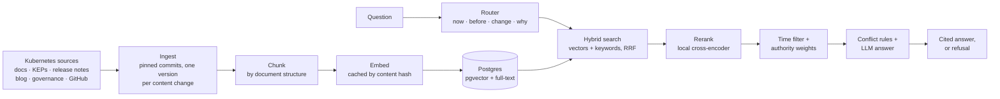
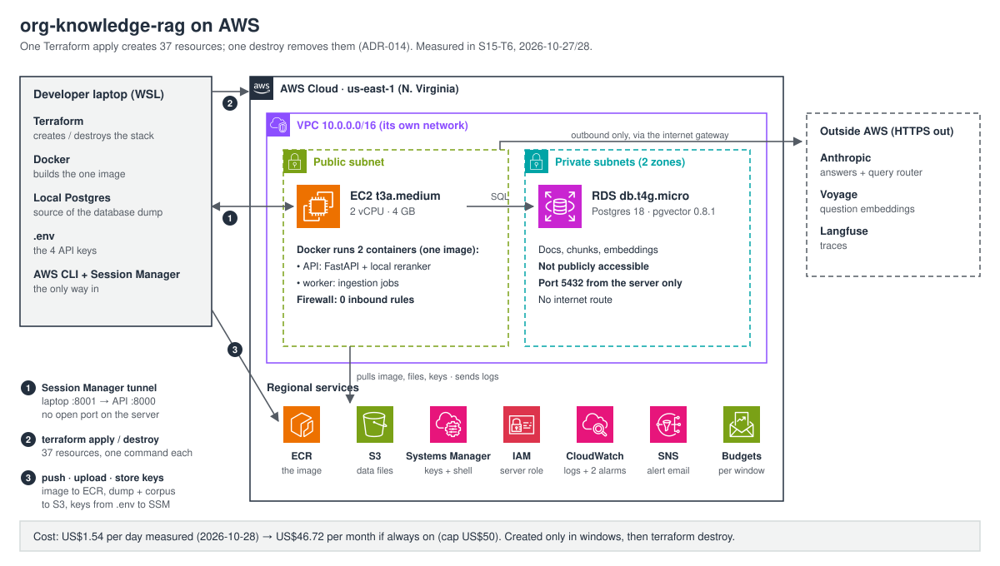

# Organizational Knowledge & Decision Intelligence RAG

[](https://github.com/JasonServito/org-knowledge-rag/actions/workflows/ci.yml)

A retrieval-augmented generation (RAG) system that treats **time, source authority and conflicts** as data, instead of leaving them for the LLM to guess.

- **Corpus:** ~1,170 public Kubernetes documents across 18 releases (1.20–1.37): docs pages, KEPs (Kubernetes Enhancement Proposals: each feature's design doc), release notes, blog posts, governance docs, GitHub discussions.
- **Questions:** what's true **now**, what was true **before**, **how** it changed, **why** it changed. Every answer cites its sources.
- **Refusals:** it says so when the public record doesn't hold the answer.

## Demo (4 min 48 s)

The finished system on AWS: cited answers, conflicts, a refusal, and one question traced through AWS's logs into Langfuse.

https://github.com/user-attachments/assets/201de198-b3de-41a9-9278-6fd2b9498336

## Why it's harder than "chat with your docs"

- **Knowledge changes:** the right answer depends on the release you ask about.
- **Sources differ in trust:** a reference page outranks a blog post.
- **Sources disagree:** a KEP can claim "stable" while the reference page says "beta".

A plain RAG pipeline blends all of this into one answer. This one stores each document version with the releases it was valid in, ranks sources by trust, and flags conflicts before answering.

## How it works



| Step | What it does |
|---|---|
| Versions | Each version records the releases it was valid in ([ADR-002](docs/decisions/ADR-002-versioning-and-identity.md)) |
| Hybrid search | Vector + keyword search, merged with RRF (Reciprocal Rank Fusion: combines two ranked lists) |
| Rerank | A local cross-encoder rescores each candidate against the question ([ADR-008](docs/decisions/ADR-008-reranker.md)) |
| Time and trust | A router labels the question; "now" drops replaced text; each kind boosts the sources it trusts ([ADR-003](docs/decisions/ADR-003-authority-and-status.md), [ADR-009](docs/decisions/ADR-009-query-mode-routing.md)) |
| Conflicts | Code rules check stored facts, the model adds disagreeing texts, code settles each ([ADR-010](docs/decisions/ADR-010-conflict-detection.md)) |
| Answer | Structured output; citing anything not retrieved turns it into a refusal |

## Results

- **Golden set:** 43 questions (36 answerable, 7 to refuse). An LLM drafted the labels and checked each in 3 passes; I reviewed 6 by hand.
- **The rule:** a stage was kept only if its target metric rose ≥ 0.03 and nothing else fell > 0.03, fixed before its paid eval ([product spec](docs/product-spec.md)).

| Metric | Baseline (vector search only) | Final pipeline (Phase 1, 2026-10-12) | Change |
|---|---|---|---|
| Recall@10 (labeled sources in the top 10) | 0.384 | **0.552** | +44% |
| Hit@10 (questions with a good source) | 34 of 36 | **36 of 36** | +2 |
| MRR (rank of the first good source) | 0.614 | **0.813** | +32% |
| nDCG@10 (ranking quality) | 0.369 | **0.535** | +45% |
| Outdated results, "now" questions | 39 of 100 | **0 of 100** | −39 |
| Results in a dated question's window | 31 of 90 | **47 of 90** | +16 |
| Most trusted source ranked first | 3 of 9 | **9 of 9** | +6 |
| "Now" answers citing only current text | 2 of 10 | **8 of 10** | +6 |
| "Back then" answers citing text of that time | 6 of 9 | **8 of 9** | +2 |
| Citations present, none invented, refusals right | 100% | **100%** | kept |
| Conflicts surfaced (precision, recall) | none | **0.955–1.000, 0.317–0.350** | new |
| p95 latency per question | 10.7 s | 16.3 s | +5.6 s (ceiling 23 s) |
| Cost per question | $0.0295 | $0.0378 | +$0.0083 (ceiling $0.06) |

**What each stage added:**

| Stage | Main effect |
|---|---|
| + keyword search | MRR 0.614 → 0.675 |
| + reranker | Recall@10 0.382 → 0.516, for +1.3 s p95 |
| + time filter | Outdated "now" results 38 → 0 of 100 |
| + authority weights | Most trusted source first 5 → 9 of 9 |
| + conflict detection | The 2 code rules were right 8 of 8 times |
| + corrective retrieval | Tested, **not adopted**: no grader told thin evidence from enough ([ADR-011](docs/decisions/ADR-011-corrective-retrieval.md)) |

**Where it falls short** ([Phase 1 report](docs/m1-report.md)):

- Conflicts surfaced on 1 of 4 hand-picked seed cases.
- 2 of 10 "now" answers also cite older text; 1 of 9 "back then" answers cites only later text.
- The 2 answer-citation checks were chosen on these runs, so a fresh golden set is their clean test.
- **Today's numbers are a little lower:** adding the GitHub discussions (for decision provenance) moved Recall@10 to 0.522, Hit@10 to 35 of 36, MRR to 0.781 and nDCG@10 to 0.508, with 2 answerable questions refused ([final benchmark](docs/evaluation.md#final-benchmark-s18)). These are the numbers in the video. No scoring was changed to hide it.

Details: [evaluation report](docs/evaluation.md) · [ablation table](eval/results/ablation.md). Latency is laptop CPU (Intel Core Ultra 7, no GPU).

## Example answer

Trimmed to 1 of its 4 citations. A code rule catches the KEP's "stable" claim against the reference page's "beta":

```json
{
  "question": "What are the release stages of strict IP/CIDR validation (KEP-4858)?",
  "answer_status": "answered",
  "answer": "[...] It went to beta in v1.36, enabled by default, and is still beta as of 1.37. [...] The observed beta stage wins, so it has not reached GA as of 1.37.",
  "evidence": [
    {"document": "gate:StrictIPCIDRValidation", "release_windows": [["1.36", null]], "tier": 1}
  ],
  "conflicts": [
    {
      "kind": "claim_mismatch",
      "found_by": "rule",
      "summary": "kep:4858 claims stable; the feature-gate reference at 1.37 says beta.",
      "resolution": "observed_beats_claimed"
    }
  ]
}
```

## Decision provenance

`orgknow chain kep:2572` explains why Kubernetes moved from 4 to 3 releases a year, in 6 dated steps: problem → discussion → proposal → decision → implementation → current docs.

- **Built by rules, not an LLM,** from links Kubernetes records: tracking issues, `/approve` by Prow (Kubernetes' review bot), merges ([ADR-012](docs/decisions/ADR-012-decision-provenance.md)).
- **Result:** 6 of 6 steps on the development chain, 5 of 6 on a random held-out one. Plain search gets 3 and 1.
- **Caveat:** 2 chains show it works, not a success rate.

## Deployment on AWS



| | |
|---|---|
| Infrastructure | Terraform: 37 resources (EC2, RDS, S3, ECR, IAM, CloudWatch, SSM); no open ports, a Session Manager tunnel |
| Deploys | `make deploy`: build, scan, push, start |
| Same as the laptop | Identical database fingerprint and retrieval scores |
| Speed | Search p95 78.0 s on 2 vCPUs → **7.40 s** on 4 cores (an in-place resize for demos); a live answer in 10.9 s |
| Cost | ~US$47/month if always on, so it ran only in windows (3) and was torn down |
| Last window | ~22 hours, US$4.89 (~US$2.95 of it a server left on 4 cores overnight) |

Evidence: [deployment-evidence.md](docs/deployment-evidence.md) · runbook: [deployment.md](docs/deployment.md) · design: [ADR-014](docs/decisions/ADR-014-deployment-topology.md)

## Engineering

- **API:** FastAPI; one error shape, request IDs, JSON logs ([interfaces](docs/interfaces.md)).
- **UI:** a private Next.js page: answers, trust badges, conflicts, a release timeline, decision chains ([ADR-016](docs/decisions/ADR-016-ui.md)).
- **Background jobs:** a worker runs queued rebuilds from a Postgres table ([ADR-013](docs/decisions/ADR-013-async-ingestion.md)).
- **Reproducible data:** pinned commits; a rebuild gives a byte-identical fingerprint.
- **Tests:** `mypy --strict`, 1,135 unit, 254 integration (real Postgres), 65 UI tests and a browser smoke test, all in CI.
- **Decisions:** 16 ADRs, each with the options rejected ([docs/decisions](docs/decisions/)).

**Stack:** Python 3.12 · Postgres 18 + pgvector · FastAPI · Next.js · Voyage embeddings · Claude · PyTorch cross-encoder · Langfuse · Docker · Terraform · AWS · GitHub Actions · uv

## Quickstart

Needs Docker, `make` and [uv](https://docs.astral.sh/uv/) (Linux, macOS or WSL2).

```bash
git clone https://github.com/JasonServito/org-knowledge-rag.git
cd org-knowledge-rag
cp .env.example .env   # local settings
uv sync                # Python 3.12 + pinned dependencies
make up                # start Postgres + pgvector
make migrate           # apply migrations
make check             # lint, types, unit tests
make test-int          # integration tests
```

Corpus loading, paid questions, the API, the UI and the evals: [docs/usage.md](docs/usage.md).

## Documentation

| Doc | Purpose |
|---|---|
| [`docs/usage.md`](docs/usage.md) | Setup and every command |
| [`docs/architecture.md`](docs/architecture.md) | What the code does |
| [`docs/evaluation.md`](docs/evaluation.md) | Every eval and how to read it |
| [`docs/m1-report.md`](docs/m1-report.md) | Phase 1 closeout, with proofs |
| [`docs/decisions/`](docs/decisions/) | Architecture Decision Records |
| [`docs/deployment.md`](docs/deployment.md) | AWS runbook |
| [`docs/deployment-evidence.md`](docs/deployment-evidence.md) | What each AWS window measured |
| [`docs/security-review.md`](docs/security-review.md) | Risks, controls and known limits |
| [`docs/future-work.md`](docs/future-work.md) | What it would do next |
| [`docs/product-spec.md`](docs/product-spec.md) | Scope and acceptance criteria |
| [`docs/research/`](docs/research/) | Corpus selection research |

## How it was built

Built with AI coding tools. I made every design decision, recorded each as an ADR, and fixed each stage's improvement rule before its paid eval.

## Data and licensing

- Kubernetes docs: CC BY 4.0. KEPs and code: Apache-2.0. Every answer cites its source URL and release.
- The corpus is **not** redistributed here: only ingestion code and source manifests.
- Independent project, **not affiliated with or endorsed by** Kubernetes or the CNCF.
- Code license: [MIT](LICENSE) (the code only, not the corpus).
