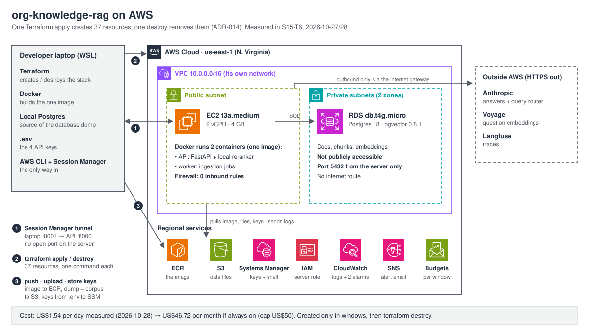
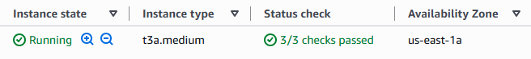
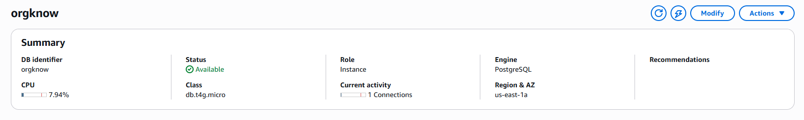

# Deployment evidence

What the AWS deployment (ADR-014) did when it really ran: the commands' output, with values copied, some lines trimmed or lined up, and everything sensitive redacted. Notes in parentheses or after the values are added. The steps are in [`deployment.md`](deployment.md).

- **The environment exists only in windows** (ADR-014's 2026-10-16 amendment). Each window gets its own section here: S15-T6, S16-T6 and S18-T4 (up to 2 days: ADR-014's 2026-11-02 amendment).
- **Redacted:** the account ID (also inside bucket names, registry URLs and ARNs), API keys, the alert email, instance and session IDs, and IP addresses. Request and trace IDs are kept: they are the proof.

## Window 1: S15-T6, the first deploy (2026-10-27 to 2026-10-28)



### Summary

| Check | Result |
|---|---|
| `terraform apply` | 37 resources in 8 min 25 s |
| Database load | dump restored on RDS in 1 min 30 s (the restore alone), exit 0 |
| pgvector on RDS (ADR-004) | `vector 0.8.1`, `btree_gist 1.8`, the laptop's versions |
| RDS fingerprint | `sha256:0f0ee078…4165`, equal to the laptop's |
| Worker job | `succeeded` in 62 s; 0 new texts, 0 Voyage requests |
| Retrieval eval in the cloud | 5 metric lines identical to the laptop's |
| **Retrieve time** | **p50 57.8 s, p95 78.0 s**: over ADR-014 D2's 15 s line (see below) |
| Live question | `200` in 54.1 s, `answered`, 9 citations |
| Request ID → AWS's logs → Langfuse | found in CloudWatch, trace arrived in Langfuse |
| Connections (ADR-005) | `max_connections` 79, peak 2, connect 34–40 ms: no pool needed |
| Database exposure | not publicly accessible; port 5432 open to the server only; server: 0 inbound rules |
| Daily cost (2026-10-28, a full UTC day) | US$1.54 gross → US$46.72 a month if always on (cap US$50) |
| Teardown | 37 destroyed in 7 min 2 s; every leftover check prints nothing |

### The server and the database





### Create (runbook step 2)

```
Plan: 37 to add, 0 to change, 0 to destroy.
Apply complete! Resources: 37 added, 0 changed, 0 destroyed.
aws_instance.server: Creation complete after 16s
aws_db_instance.main: Creation complete after 8m3s
```

The tagged resources, read before teardown by their `Project = orgknow` tag (count, service, type). They are 27 lines: the 37 minus what AWS can't tag (route-table links, firewall rules' attachments, the email subscription, the bucket's settings, the image lifecycle rule, the generated password), plus the server's disk, which AWS tags itself:

```
1 budgets budget       2 cloudwatch alarm     1 ec2 instance        1 ec2 internet-gateway
2 ec2 route-table      2 ec2 security-group   3 ec2 subnet          1 ec2 volume
1 ec2 vpc              1 ecr repository       1 iam instance-profile 1 logs log-group
1 rds db               1 rds subgrp           1 s3 bucket           1 sns topic
6 ssm parameter
```

The server's IAM role: `AmazonSSMManagedInstanceCore` (Session Manager) plus one inline policy (read its bucket, its parameters and its image; write its log group).

### Image and data (steps 4 and 5)

```
image pushed: orgknow:39d5d97 (1,451,686,101 bytes compressed; 2.61 GB on disk)
s3: orgknow.dump 118,993,454 bytes · corpus_cache.tar.gz 396,470,796 bytes

dump sha256: b0375e46e50171c43945097370ab1896920e3130be07d721450f38d2d01e4a23

restore on RDS:   real 1m30.434s   exit 0          (image pulled beforehand; laptop rehearsal: 40 s)
  extname   | extversion
 btree_gist | 1.8
 plpgsql    | 1.0
 vector     | 0.8.1
```

### Database exposure

```
RDS:  available  db.t4g.micro  postgres 18.3  PubliclyAccessible False  MultiAZ False  20 GB
database firewall:  1 rule: tcp 5432 from the server's security group; 0 IP ranges
server firewall:    0 inbound rules
```

### Start and check (steps 6 and 7)

Through the Session Manager tunnel (laptop port 8001 → the server's `127.0.0.1:8000`):

```
GET /health  {"status":"ok"}
GET /ready   {"status":"ready"} 200
Fingerprint: sha256:0f0ee07847e8b05fcde7f1491c628618cfb42a555ec5b098f1c2effd52ee4165
```

The free worker job (it re-reads the unpacked corpus):

```
succeeded 2026-10-27T18:13:45.358250Z 2026-10-27T18:13:46.493299Z 2026-10-27T18:14:48.149533Z   (created, started, finished: 62 s)
['ingest succeeded', 'lifecycle succeeded', 'embed succeeded', 'chains succeeded']
ingest: new_versions 0, new_chunks 0, new_documents 0, documents_stored 1173, failures 0, fingerprint = the above
embed:  requests 0, texts 0, tokens 0
```

### The retrieval eval in the deployed container

```
Mode: authority (candidates 20, k 60, width 100, model BAAI/bge-reranker-base@2cfc18c, max length 512, router claude-opus-5-5, slack 1, boost 1.25, demote 0.8). Answerable questions: 36.
Recall@10 0.522  Hit@10 0.972  MRR 0.781  nDCG@10 0.508
Stale rate 0.000 (0 of 100 CURRENT hits)  Temporal accuracy 0.522 (47 of 90 dated HISTORY hits)
Authority selection 0.889 (8 of 9 CURRENT questions)  CURRENT MRR 0.733
Router accuracy 0.972 (35 of 36)  Windows 7 of 9 (0 extra)  Plans: 10 current-only, 7 windowed, 19 unfiltered
Rule conflicts: 5 claim_mismatch (q16 q17 q18 q19 q32), 0 history_date
Retrieve time: p50 57.83 s, p95 78.04 s (36 questions). Reranker load 13.9 s.
```

- **The quality is unchanged:** the first 5 lines equal the laptop's (PR #51).
- **The speed is not:** about 5× the laptop pinned to 2 CPUs (p50 11.50 s, p95 15.36 s; `evaluation.md`). ADR-014 D2's 15 s rule triggered: recorded, not changed, for the next design review.
- **Likely cause:** CPU stayed at ~47%, one of the 2 vCPUs. A t3a.medium's 2 vCPUs are 1 physical core, and the reranker uses one thread per physical core. The rest is the server's slower core.
- **Not throttled:** the CPU credit balance never reached 0 (lowest: 9.6).

### A live question, traced (7.6c)

```
POST /query {"question": "What enforces pod security standards in-tree?"}
200 in 54.124147 s
answered 9 citations, trace_id 7559c48e03def1edbd88cf7f3a686232
x-request-id: f95d2f9e78e04bb992f654f67841f678
```

The answer begins: "Pod Security Standards are enforced in-tree by Kubernetes' built-in Pod Security admission controller (Pod Security Admission, the `PodSecurity` admission plugin)…". Its first citations are the Pod Security Admission concept page and the "Enforce Pod Security Standards" task pages.

The same request ID in AWS's own logs (CloudWatch, group `/orgknow`, stream `api`):

```
{"message": "POST /query 200", "request_id": "f95d2f9e78e04bb992f654f67841f678", "status": 200, "duration_ms": 54053.5, "trace_id": "7559c48e03def1edbd88cf7f3a686232"}
```

Its trace in Langfuse (the public API's observations, by trace ID):

```
SPAN       ask       19:56:09.314Z → 19:57:03.337Z   54.0 s
SPAN       retrieve  19:56:11.095Z → 19:56:57.817Z   46.7 s
GENERATION generate  19:56:57.840Z → 19:57:03.334Z    5.5 s
SPAN       validate  19:57:03.335Z                    0 s
```

Retrieval is 86% of the question: the reranker again.

### Connections (7.6d, ADR-005's trigger)

```
max_connections                 79
open connections after the ask  2 (one is the psql itself)
peak, RDS metric over 3 hours   2
connect, API container → RDS    34 ms and 40 ms
```

A pool is needed if the limit is under 2× the peak (79 vs 4) or a connect is over 5% of a median ask (40 ms vs 2.7 s). Neither holds.

### Cost (7.6e)

The full UTC day 2026-10-28, gross (credits and tax left out), by service:

```
Amazon Elastic Compute Cloud - Compute   0.9024        24 h × US$0.0376 (t3a.medium)
Amazon Relational Database Service       0.4581935472  db.t4g.micro + 20 GB
Amazon Virtual Private Cloud             0.12          24 h × US$0.005 (public IPv4)
EC2 - Other                              0.0516129024  the server's disk
Amazon EC2 Container Registry (ECR)      0.0043612512
Amazon Simple Storage Service            0.0003661762
CloudWatch, SNS, KMS, Glue               0
total                                    1.536933877   × 30.4 = US$46.72 a month
```

- **Net** (after credits): 1.536933877, the same: the account has no credits. **Tax:** 0 so far (it appears when the month is billed).
- **The estimate held:** the cost table said US$1.56 a day, US$47.49 a month.
- **The window's days:** Oct 27 US$0.44 (from 11:05 MDT) · Oct 28 US$1.54 · Oct 29 US$0.25 (until the teardown at 22:02 MDT) · Oct 30 US$0.0022 (RDS backups, after it). About **US$2.23** in all, before tax and the cost queries (US$0.01 each). All figures are Cost Explorer's estimates until October's bill closes.
- **Budget** (as text, not a screenshot): US$5 for this window, emailing at 80% of actual and 100% of forecast spend to a confirmed address. It counts credits, which this account doesn't have. No alert email was sent.

### Teardown (step 9)

```
Plan: 0 to add, 0 to change, 37 to destroy.
Apply complete! Resources: 0 added, 0 changed, 37 destroyed.
aws_instance.server: Destruction complete after 33s
aws_db_instance.main: Destruction complete after 6m56s
```

Then every check printed nothing: Terraform's state; servers (only `terminated`); databases; database snapshots; buckets; IP addresses; disks; image repositories. The database's 2 automatic daily snapshots were still listed right after the delete; AWS removed them within a minute.

The first full day after the teardown, 2026-10-30 (read 2026-10-31):

```
AWS Cost Explorer                    0.04          the 4 cost queries of 2026-10-30
Amazon Relational Database Service   0.0022049278  RDS:ChargedBackupUsage, 0.023 GB-month: the deleted database's backups, billed once
AWS Glue                             0
```

Nothing of the stack bills any more: the day's only charges are the cost queries and a one-off backup-storage line, and no database snapshot or retained backup is left (both lists empty). October's tax still reads 0.

### Time

- **Day 1:** about 2 hands-on hours across 10:51–15:00 MDT. The eval ran ~40 minutes of that, and a doubly pasted API key cost ~10 minutes (a failed question, then a restart).
- **Teardown:** about 20 minutes. **Cost reading:** about 10 minutes.

## Window 2: S16-T6, `make deploy` (2026-11-01)

The first run of `make deploy` against a stack (ADR-015 D2). The plan, its decisions and the calls are in the S16 slice doc (T6). Times are UTC.

### Summary

| Check | Result |
|---|---|
| `terraform apply` | 37 resources in 7 min 40 s (RDS 7 min 28 s); budget US$2 for this window |
| Database load | restored on RDS in 1 min 20 s, exit 0 |
| Deploy 1, first try | the push worked; stopped at the scan wait: `ScanNotFoundException` seconds after the push (a bug; fixed: decision t2) |
| Deploy 1, second try | stopped by the CRITICAL gate: CVE-2026-111497 in Debian's `libbrotli1` (the gate working; fixed: decision t3) |
| Deploy 1, third try | `Success`: both gates passed, `/ready: 200`, the fingerprint equal to the laptop's, in 3 min 45 s |
| The credential helper | `credHelpers` only in root's Docker config; no `cache.json` in `/root/.ecr` |
| Deploy 2 (the next commit) | `Success` in 55 s: the running containers removed, the migration run, 2 new containers; `/ready: 200`, the same fingerprint |
| Teardown | `Destroy complete! Resources: 37 destroyed.` in 2 min 13 s; every leftover check prints nothing |
| Time | stack 1 h 2 min (17:46–18:49); the window 1 h 34 min (17:16–18:50), with ~20 min lost to a phone clock (see "Time") |

### Create, keys and data (runbook steps 2, 3 and 5)

```
Plan: 37 to add, 0 to change, 0 to destroy.
aws_instance.server: Creation complete after 17s
aws_db_instance.main: Creation complete after 7m28s
Apply complete! Resources: 37 added, 0 changed, 0 destroyed.
real	7m39.927s

ANTHROPIC_API_KEY: length 106, equal to .env: yes
VOYAGE_API_KEY: length 46, equal to .env: yes
LANGFUSE_PUBLIC_KEY: length 42, equal to .env: yes
LANGFUSE_SECRET_KEY: length 42, equal to .env: yes

s3: orgknow.dump 118,993,454 bytes · corpus_cache.tar.gz 396,470,796 bytes (uploaded in 23.5 s)
dump sha256: 10b9c9ed42f69ddfb3f884de76ea29d97a981203ada32fcd6c10fe26bfa6343f

restore on RDS:   real 1m20.176s   exit 0
```

### Deploy 1, try 1: the scan wait failed (`921a8fe`, 18:10)

The audit and the image check passed, and the push worked. Then:

```
921a8fe: digest: sha256:9ec7ac26c85f9b63b3cf6a70cf78bf5c23a29c6bf4db0366be44b505949f55f3 size: 3259
deploy: pushed <account>.dkr.ecr.us-east-1.amazonaws.com/orgknow:921a8fe
aws: [ERROR]: Waiter ImageScanComplete failed: An error occurred (ScanNotFoundException): Image scan does not exist for the image with '{imageDigest:'null', imageTag:'921a8fe'}' in the repository with name 'orgknow' in the registry with id '<account>'
deploy: ECR's scan of 921a8fe did not complete
```

- A minute later the scan existed (`IN_PROGRESS`), and the repository has `scanOnPush: true`: AWS's waiter fails at once on a scan that doesn't exist yet, instead of waiting for it.
- **Fix (decision t2, `789b1c8`):** `scripts/deploy.sh` first waits up to 60 s for the scan to exist, then runs the waiter.

### Deploy 1, try 2: the CRITICAL gate (`789b1c8`, 18:17)

`scripts/` isn't in the image, so this was the same image under a new tag; its scan already existed, and the wait passed at once:

```
789b1c8: digest: sha256:9ec7ac26c85f9b63b3cf6a70cf78bf5c23a29c6bf4db0366be44b505949f55f3 size: 3259
deploy: ECR scan: {"HIGH":17,"MEDIUM":16,"LOW":4,"CRITICAL":1}
CVE-2026-111497	https://nvd.nist.gov/vuln/detail/CVE-2026-111497
deploy: ECR found 1 CRITICAL findings in <account>.dkr.ecr.us-east-1.amazonaws.com/orgknow:789b1c8: not deploying
```

- The finding: a buffer overflow in the Brotli decoder (CVSS 9.2), package `brotli` 1.1.0-2 (installed: `libbrotli1` 1.1.0-2+b7, Debian 13.7). The only installed package that depends on it is `libcurl3t64-gnutls` (`apt-cache rdepends --installed libbrotli1` in the image: `Reverse Depends: libcurl3t64-gnutls`), the library git uses for HTTP, which the image disallows (`GIT_ALLOW_PROTOCOL=file`); the gate stops on any CRITICAL all the same (ADR-015 D4).
- `apt-cache policy libbrotli1` in the image: `Candidate: 1.1.0-2+deb13u1`.
- **Fix (decision t3, `233b501`):** the `Dockerfile` upgrades `libbrotli1` to `1.1.0-2+deb13u1` in its own late layer (rebuild 9.5 s); `image-check: ok`; `git version 2.47.3`.

### Deploy 1, try 3: success (`233b501`, 18:21)

A new image, so ECR scanned it from scratch. Whether the scan existed when the wait began is unknown: the new loop prints nothing (see "Not verified").

```
deploy: audit
No known vulnerabilities found
torch Dependency not found on PyPI and could not be audited: torch (2.14.1+cpu)
deploy: image 233b501
image-check: ok (uid 10001, GIT_ALLOW_PROTOCOL=file, safe.directory *)
Login Succeeded
233b501: digest: sha256:78da560c08aeecc12d16caaddaf65642b5ef5e69b26a8f4e50ba3b56bfdfa784 size: 3469
deploy: pushed <account>.dkr.ecr.us-east-1.amazonaws.com/orgknow:233b501
deploy: ECR scan: {"HIGH":17,"MEDIUM":16,"LOW":4}
deploy: server: command <id> sent; polling every 10 s, up to 20 min
deploy: server: Success
<account>.dkr.ecr.us-east-1.amazonaws.com/orgknow:233b501
CONTAINER ID   IMAGE                                                   COMMAND                  CREATED        STATUS                  PORTS                      NAMES
7605e2a01de6   <account>.dkr.ecr.us-east-1.amazonaws.com/orgknow:233b501   "python -m orgknow.i…"   1 second ago   Up Less than a second   8000/tcp                   orgknow-worker
779c5d3420ec   <account>.dkr.ecr.us-east-1.amazonaws.com/orgknow:233b501   "uvicorn --factory o…"   1 second ago   Up Less than a second   127.0.0.1:8000->8000/tcp   orgknow-api
/ready: 200
Fingerprint: sha256:0f0ee07847e8b05fcde7f1491c628618cfb42a555ec5b098f1c2effd52ee4165
INFO  [alembic.runtime.migration] Context impl PostgresqlImpl.
INFO  [alembic.runtime.migration] Will assume transactional DDL.
deploy: done: <account>.dkr.ecr.us-east-1.amazonaws.com/orgknow:233b501. Compare the fingerprint with the laptop's (make ingest-report).
real	3m44.684s
```

- The laptop's `make ingest-report`: `Fingerprint: sha256:0f0ee07847e8b05fcde7f1491c628618cfb42a555ec5b098f1c2effd52ee4165`, the same.
- No `Running upgrade` line: the restored database was already at the newest migration.
- The pull's and the containers' IDs from Docker's output (2 lines) are left out.

### The credential helper (ADR-015 D3)

On the server, after deploy 1:

```
sh-5.2$ sudo cat /root/.docker/config.json
{"credHelpers": {"<account>.dkr.ecr.us-east-1.amazonaws.com": "ecr-login"}}
sh-5.2$ sudo ls -la /root/.ecr
total 0
drwx------. 3 root root  17 Nov  1 18:23 .
dr-xr-x---. 6 root root 142 Nov  1 18:23 ..
drwx------. 2 root root  27 Nov  1 18:23 log
```

The pull used the helper (no `docker login` on the server), and no token is on disk: only `log/`, no `cache.json`.

### Deploy 2: the replace path (`ce771f7`, 18:35)

From the next commit (deploy 1's evidence: docs only, so the patched image under a new tag), with deploy 1's containers running:

```
ce771f7: digest: sha256:78da560c08aeecc12d16caaddaf65642b5ef5e69b26a8f4e50ba3b56bfdfa784 size: 3469
deploy: pushed <account>.dkr.ecr.us-east-1.amazonaws.com/orgknow:ce771f7
deploy: ECR scan: {"HIGH":17,"MEDIUM":16,"LOW":4}
deploy: server: command <id> sent; polling every 10 s, up to 20 min
deploy: server: Success
<account>.dkr.ecr.us-east-1.amazonaws.com/orgknow:ce771f7
orgknow-api
orgknow-worker
CONTAINER ID   IMAGE                                                   COMMAND                  CREATED                  STATUS                  PORTS                      NAMES
e95d81660e3d   <account>.dkr.ecr.us-east-1.amazonaws.com/orgknow:ce771f7   "python -m orgknow.i…"   Less than a second ago   Up Less than a second   8000/tcp                   orgknow-worker
370ab895784a   <account>.dkr.ecr.us-east-1.amazonaws.com/orgknow:ce771f7   "uvicorn --factory o…"   1 second ago             Up Less than a second   127.0.0.1:8000->8000/tcp   orgknow-api
/ready: 200
Fingerprint: sha256:0f0ee07847e8b05fcde7f1491c628618cfb42a555ec5b098f1c2effd52ee4165
INFO  [alembic.runtime.migration] Context impl PostgresqlImpl.
INFO  [alembic.runtime.migration] Will assume transactional DDL.
real	0m55.256s
```

- `orgknow-api` and `orgknow-worker` are `docker rm -f` removing deploy 1's running containers: the step a first deploy skips. Then the migration (a no-op) and the 2 new containers.
- The registry before teardown: 2 images, 4 tags (`921a8fe`, `789b1c8` on the first; `233b501`, `ce771f7` on the patched one).

### Teardown (step 9)

```
Plan: 0 to add, 0 to change, 37 to destroy.
aws_instance.server: Destruction complete after 28s
aws_db_instance.main: Destruction complete after 1m56s
Destroy complete! Resources: 37 destroyed.
real	2m12.947s
```

`terraform destroy`'s own last line, this time (S15-T6 applied a saved destroy plan). Then the 8 checks: Terraform's state, servers (one `terminated`), databases, database snapshots, `orgknow` buckets, IP addresses, disks and image repositories each printed nothing. `infra/terraform.tfvars` was deleted; `make tf-check`: `11 passed, 0 failed`.

### Time

| UTC | Step |
|---|---|
| 17:16–17:21 | Free pre-flight: `make audit`, `make image`, the laptop fingerprint, the dump and the archive |
| 17:21–17:42 | Sign-in blocked at MFA: the phone's clock was an hour slow (set by hand after Alberta stayed on UTC−6 on 2026-11-01); fixed by turning network time back on |
| 17:43–17:55 | `plan`, `apply` (7 min 40 s), the 4 keys, the upload |
| 17:55–18:10 | The restore on the server (developer; the gap between the logged steps, not timed) |
| 18:10–18:25 | Deploy 1: 3 tries, 2 fixes (decisions t2 and t3) |
| 18:25–18:35 | The credential-helper check (developer); deploy 1's evidence committed |
| 18:35–18:37 | Deploy 2 |
| 18:46–18:50 | `destroy` (2 min 13 s), the 8 checks |

- **Stack time:** 1 h 2 min (`apply` started 17:46:19, `destroy` ended 18:48:41): about US$0.07 at S15's US$1.54 a day. The window's real cost is read in T7.
- **The window:** 1 h 34 min from the first command to the last check, under ADR-014's 2-hour line, including ~20 min on the phone clock and ~10 min on the 2 fixes.

### What the window found

- **A bug in `make deploy`:** AWS's scan waiter fails at once when the scan doesn't exist yet. Fixed in `scripts/deploy.sh` (decision t2); tries 2 and 3 passed through it, but neither output shows the loop waiting for a missing scan.
- **A CRITICAL in the base image's OS packages** (CVE-2026-111497, `libbrotli1`), which the CI image job and the laptop can't see: only ECR's scan reads them. Fixed by Debian's update in the `Dockerfile` (decision t3). The gate stopped the deploy as ADR-015 D4 designed.
- **For T7's runbook fixes:** the runbook's step 6 table has no row for the first stop (the scan didn't exist yet), and no step for a CRITICAL with a Debian fix (an `apt-get` upgrade line in the `Dockerfile`, as here).

### Not verified in this window

- That the new wait handles a missing scan: on tries 2 and 3 the waiter found the scan, but the loop prints nothing, so whether it ever waited is unknown; how long ECR takes to create a scan wasn't measured.
- That `1.1.0-2+deb13u1` is the Debian fix for CVE-2026-111497 by name: ECR's rescan no longer lists it (try 3), which is the gate's own test; Debian's advisory wasn't read.
- A deploy whose migration changes the database, and the rollback after one (S16 decision p2's laptop drill).
- The window's cost by service (T7, a day after).

## Window 3: S18-T4, demo hours and the demo video (2026-11-03 to 2026-11-04)

The finished system on AWS, resized to 4 cores for demo hours (ADR-014's 2026-11-02 amendment), recorded as the demo video, then torn down. The plan, its decisions (t1–t7) and the calls are in the S18 slice doc (T4). Times are UTC.

### Summary

| Check | Result |
|---|---|
| Free checks (the day of the window) | no-cache image 2 min 6 s, `image-check: ok`; c7a.xlarge and c7a.2xlarge offered in `us-east-1a`; vCPU limit 8 |
| `terraform apply` | 37 resources in 8 min 12 s; budget US$6 |
| Database load | restored on RDS in 90 s, exit 0; `btree_gist 1.8`, `plpgsql 1.0`, `vector 0.8.1` |
| `make deploy` | `Success` in 12 min 15 s; **the scan wait printed 7 lines** (T2's line, proven); scan HIGH 4, MEDIUM 10, LOW 3; `/ready: 200`; the fingerprint equal to the laptop's |
| Resize to c7a.xlarge | in place (`0 to add, 1 to change, 0 to destroy`), 52 s; no credit line in the plan; both containers back on their own; `torch threads 4` |
| **Retrieval eval on 4 cores** | **the 5 metric lines identical to the laptop's; retrieve p50 5.51 s, p95 7.40 s** (t3a.medium: p50 57.8 s, p95 78.0 s); 3 min 29 s |
| Live question through the tunnel | `200` in 10.9 s, `answered`, 9 citations (t3a.medium: 54.1 s) |
| The video's 4 asks (take 3) | 14.8 s, 18.0 s, 17.0 s, 10.2 s (the server's `duration_ms`) |
| Resize back to t3a.medium | in place, 3 min 1 s; credits `standard`; then `No changes.`; both containers back, `/ready: 200` |
| Teardown | `37 destroyed` in 2 min 36 s; every leftover check prints nothing; `make tf-check` 11 passed |
| **A missed rule** | the server stayed on c7a.xlarge overnight, ~20 h 56 min (19:09 on 11-03 to 16:05 on 11-04), against t3's "back to t3a.medium before any break over 1 hour" |
| Stack time and cost | 21 h 32 min (apply 18:40:23 on 11-03, destroy 16:12:18 on 11-04): **US$4.89 gross** (Cost Explorer, read 2026-11-05; estimated US$5.36 beforehand) |

### Create, keys, data and deploy (runbook steps 2, 3, 5 and 6)

```
Plan: 37 to add, 0 to change, 0 to destroy.     (budget limit_amount "6", instance_type "t3a.medium")
Apply complete! Resources: 37 added, 0 changed, 0 destroyed.
real	8m11.684s

ANTHROPIC_API_KEY: length 106, equal to .env: yes
VOYAGE_API_KEY: length 46, equal to .env: yes
LANGFUSE_PUBLIC_KEY: length 42, equal to .env: yes
LANGFUSE_SECRET_KEY: length 42, equal to .env: yes

s3: orgknow.dump 118,993,454 bytes · corpus_cache.tar.gz 396,470,796 bytes (uploaded in 24 s)
dump sha256: 68bd08d91957be3f8585504dc4a43578919d07174df50b6faf14e1de2a694471

restore: exit 0, 90 s
btree_gist|1.8
plpgsql|1.0
vector|0.8.1
```

- The restore ran through Run Command (step 5's server commands in one script), not an interactive shell.
- `make deploy`'s first try stopped at once: the slice doc had an uncommitted edit (`deploy: uncommitted changes to tracked files`). Committed, then:

```
deploy: image 1f13d3e
image-check: ok (uid 10001, GIT_ALLOW_PROTOCOL=file, safe.directory *)
deploy: pushed <account>.dkr.ecr.us-east-1.amazonaws.com/orgknow:1f13d3e
deploy: waiting for ECR's scan of 1f13d3e to start (1 of 12)
  … (2 to 6 of 12)
deploy: waiting for ECR's scan of 1f13d3e to start (7 of 12)
deploy: waiting for ECR's scan of 1f13d3e to complete
deploy: ECR scan: {"HIGH":4,"MEDIUM":10,"LOW":3}
deploy: server: Success
… orgknow-worker   Up Less than a second
… orgknow-api      Up Less than a second   127.0.0.1:8000->8000/tcp
/ready: 200
Fingerprint: sha256:0f0ee07847e8b05fcde7f1491c628618cfb42a555ec5b098f1c2effd52ee4165
real	12m14.610s
```

### Demo hours (runbook "Demo hours" b–e)

```
  ~ update in-place
      ~ instance_type                        = "t3a.medium" -> "c7a.xlarge"
Plan: 0 to add, 1 to change, 0 to destroy.
Apply complete! Resources: 0 added, 1 changed, 0 destroyed.     real 0m52.076s
c7a.xlarge	running	4	1     (type, state, cores, threads per core)

orgknow-worker Up 16 seconds
orgknow-api Up 16 seconds
/ready: 200
torch threads 4

Mode: authority (candidates 20, k 60, width 100, model BAAI/bge-reranker-base@2cfc18c, max length 512, router claude-opus-5-5, slack 1, boost 1.25, demote 0.8). Answerable questions: 36.
Recall@10 0.522  Hit@10 0.972  MRR 0.781  nDCG@10 0.508
Stale rate 0.000 (0 of 100 CURRENT hits)  Temporal accuracy 0.522 (47 of 90 dated HISTORY hits)
Authority selection 0.889 (8 of 9 CURRENT questions)  CURRENT MRR 0.733
Router accuracy 0.972 (35 of 36)  Windows 7 of 9 (0 extra)  Plans: 10 current-only, 7 windowed, 19 unfiltered
Rule conflicts: 5 claim_mismatch (q16 q17 q18 q19 q32), 0 history_date
Retrieve time: p50 5.51 s, p95 7.40 s (36 questions). Reranker load 5.1 s.
real	3m29.120s
```

- p95 7.40 s is under ADR-014 D2's 15 s line, so the demo ran on c7a.xlarge (no c7a.2xlarge). The laptop's 4-core forecast (p95 10.61 s) was a pessimistic bound, not an optimistic one.

### The live question, traced (7.6c through the tunnel)

```
200 in 10.913859 s
answered 9 citations, trace_id 38928e8a381794dc0d80c9f5f9a4b3d3
x-request-id: 8cc048e7ebe846e69e486506defa6a33

{"ts": "2026-11-03T19:13:49.378+00:00", "level": "INFO", "logger": "orgknow.api.middleware", "message": "POST /query 200", "request_id": "8cc048e7ebe846e69e486506defa6a33", "method": "POST", "path": "/query", "status": 200, "duration_ms": 10839.5, "trace_id": "38928e8a381794dc0d80c9f5f9a4b3d3"}
```

- The video's part 1 question: request `11631ca5aa1e432eac0b7d7d8c5c89a6`, trace `877ccd3be62940312d4928fc4708aea7` (spans `ask` 14.73 s, `retrieve` 7.21 s, `generate` 5.64 s, `validate`), shown in the video.

### The video (decisions t4, t6, t7)

- Recorded with Recordly v1.4.0 (High, Balanced, 24 fps), take 3 of 3: 7 min 10 s, 47,444,801 bytes.
- Edited once with ffmpeg 7.0.2 (`imageio-ffmpeg==0.6.0`, run with `uv run --no-project`): the 4 waits cut, each captioned with the server's time; the 4 typing stretches at 4× (labeled); 3 part titles; 14 s of Langfuse's search table cut (its Metadata column showed the public key's prefix); the name and email in Langfuse's corner blurred.
- The developer added zooms in Recordly (exported at 1554 × 874, 56,581,647 bytes); re-encoded at CRF 28 (CRF 23 gave 13.8 MB): **4 min 48 s, 8,944,566 bytes**, sha256 `b0fe8b79f54fae1c4f977e55f5a870cc9d9aebabcb3894d6b41e8de8dec0dabc`.
- Checked frame by frame (1 every 3 s, close-ups of the Langfuse corner): no account ID, key, email or IP address. The terminated server's instance ID shows in part 3's command.

### Teardown (step 9)

```
Plan: 0 to add, 0 to change, 37 to destroy.
Apply complete! Resources: 0 added, 0 changed, 37 destroyed.     real 2m36.173s   (a saved destroy plan applied, so "Apply", not "Destroy")
1 state:            (nothing)
2 ec2:              <instance>	terminated
3 rds:              (nothing)
4 snapshots:        rds:orgknow-2026-11-03-18-45	rds:orgknow-2026-11-04-09-20, then nothing at 16:13:03
5–8 s3, addresses, volumes, ecr: (nothing)
make tf-check:      Success! 11 passed, 0 failed.    (after the terraform.tfvars delete)
```

### Paid calls

- **Anthropic:** the 15 asks on AWS (a warm-up, a test, 3 takes of 4, a false start): answers 106,440 tokens in and 9,637 out, US$0.6185, plus ~US$0.15 of untraced router calls. With the laptop rehearsal (~US$0.21): T4 ~US$0.98 of its US$1 cap.
- **AWS:** US$4.89 gross; see "Cost" below.

### Cost (read 2026-11-05 16:25 UTC)

Runbook 7.6e's commands (gross by service, net, tax), 6 Cost Explorer requests (US$0.06). AWS still marks both days `Estimated`.

| Service | 2026-11-03 | 2026-11-04 |
|---|---|---|
| EC2 compute | 1.0129 | 3.3047 |
| RDS | 0.1010 | 0.3102 |
| VPC (the server's public IPv4) | 0.0266 | 0.0810 |
| EC2 - Other (the disk) | 0.0133 | 0.0345 |
| ECR | 0.0007 | 0.0032 |
| S3 | 0.0004 | 0.0004 |
| Glue, KMS, SNS, CloudWatch | 0 | 0 |
| **Gross (US$)** | **1.1549** | **3.7340** |
| Net (credits included) | 1.1549272188 | 3.7340399127 |

- **The window: US$4.89 gross**, equal to net (no credits); tax 0 so far; 2026-11-05 so far: 0.
- **The c7a hour, from the bill:** 11-04's EC2 compute, US$3.3047 for ~16 h 5 min on c7a.xlarge (00:00–16:05), ~US$0.205 an hour; t3a.medium's ~US$0.038.
- **The missed rule's cost:** ~17.6 h on c7a.xlarge after the recording (~22:30 on 11-03 to 16:05 on 11-04) × ~US$0.167 more an hour = **~US$2.95**. Without it: ~US$1.94.

### Not verified in this window

- Whether the budget's 80% email (US$4.80) arrives: the gross passes it.
