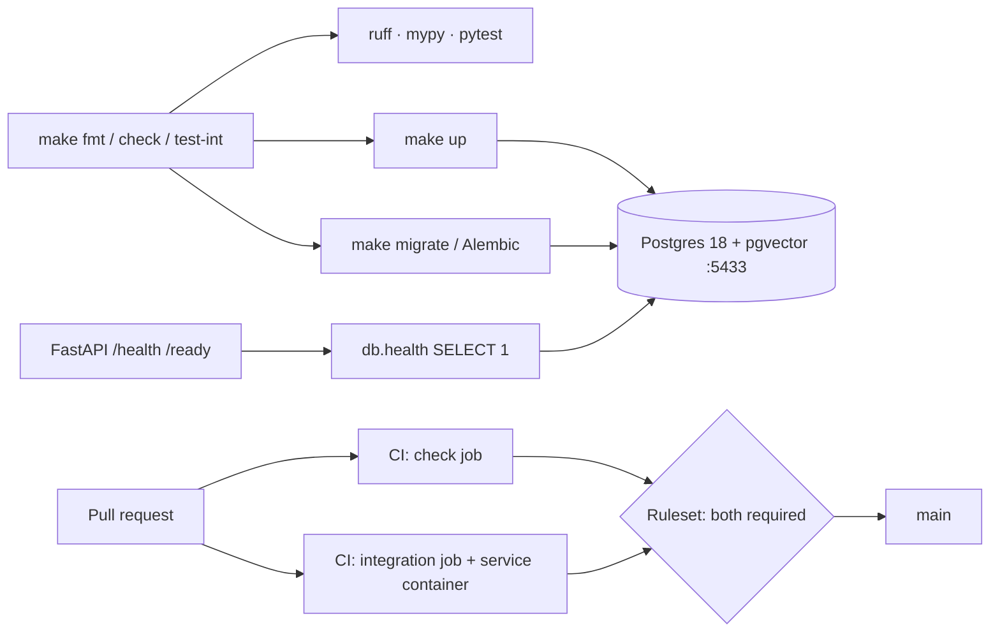

# Learning note: S01 Repo foundation

*Drafted by the AI assistant at my request; reviewed by me.*

## In my own words

S01 built the verification loop every later slice depends on. One `make` interface runs formatting, linting, strict type checking and unit tests in about a second, and integration tests run against a pinned Postgres 18 + pgvector container. Alembic manages the schema; migration `0001` only enables the `vector` extension. A minimal FastAPI app exposes `/health` (process alive) and `/ready` (database reachable). GitHub Actions runs the same Make targets, and a ruleset makes both CI jobs required before anything reaches `main`. This matters to the thesis because the project's claims (temporal correctness, authority, conflict handling) are only credible if every change is verified the same way, on every machine.

## Decisions and trade-offs

| Decision | Alternative rejected | Why | What it cost us |
|---|---|---|---|
| uv + committed `uv.lock` | Poetry | One fast tool for venv, lock and run | Newer tool; less familiar to some reviewers |
| ruff + `mypy --strict` on `src/` | flake8/black/isort; pyright | One fast linter/formatter; mypy is the most widely known checker | mypy is slower; strict mode needed the pydantic plugin |
| Image pinned by tag `0.8.1-pg18` | `latest`; digest pin | Reproducible, still picks up Postgres patch releases; matches RDS PG18 + pgvector 0.8.1 | A tag can move; the tested digest is recorded in ADR-004 |
| Host port `127.0.0.1:5433` | 5432 | 5432 was taken by another project; localhost-only binding | A non-standard port to document |
| Hand-written migrations | Alembic autogenerate | Autogenerate needs SQLAlchemy models, which would pre-empt ADR-005 | Every migration is written by hand |
| psycopg 3; SQLAlchemy only in `env.py` | psycopg2, asyncpg | Current, maintained driver; keeps data access open for ADR-005 | Two URL forms, bridged by `with_psycopg_driver`; bundled libpq isn't OS-patched |
| `Settings()` built in factories | Module-level global | Nothing reads env at import; tests are deterministic | Settings must be passed around explicitly |
| `/health` never touches the DB; `/ready` does | One combined endpoint | A DB outage shouldn't trigger process restarts | Two endpoints to maintain |
| Integration tests marked by directory | Per-test decorators | A new test can't forget its marker | File placement now carries meaning |
| CI calls Make targets; `UV_LOCKED=1`; migrate twice | Commands duplicated in YAML | Local and CI can't drift; a stale lock fails; idempotency is proven every run | Image tag duplicated in `ci.yml` |
| pre-commit (ruff only), pinned as a dev dependency | Global install; mypy/tests in hooks | Fresh clones get the same version; hooks stay fast | 5 extra dev packages |
| WSL2 Ubuntu only | Native Windows | Parity with CI and EC2; one shell, one Makefile | Windows users must set up WSL2 + Docker integration |
| MIT license | Apache-2.0 | Shortest, most familiar permissive license | No explicit patent grant (Apache-2.0 has one) |

## Concepts I now understand

See the glossary: migration, idempotent, liveness vs. readiness, lockfile, service container, pytest marker. Subtle point: a verification step can pass for the wrong reason. A global pre-commit masked a missing dependency, and the README's clone command tested `main` instead of the PR branch.

## Interview Q&A

1. **Q: What's the difference between `/health` and `/ready`, and why must `/health` not check the database?**
   **A:** `/health` is liveness: "is the process alive?" `/ready` is readiness: "can it serve traffic?" If liveness checked the DB, a DB outage would make the orchestrator restart healthy app processes repeatedly, which fixes nothing. A 503 from `/ready` just takes the instance out of rotation until the DB returns. Tested by pointing the app at a closed port.
2. **Q: Why pin the image by tag, not `latest` or a digest, and why Postgres 18?**
   **A:** `latest` isn't reproducible. A digest would also block Postgres patch releases, so a tag is the middle ground, with the tested digest recorded. Postgres 18 because RDS PostgreSQL 18 ships the same pgvector 0.8.1, so local matches cloud.
3. **Q: What does it mean that `make migrate` is idempotent, how do you prove it, and why does it matter?**
   **A:** Running it twice has the same effect as once. Alembic records applied revisions in its `alembic_version` table and skips them, and `0001` also uses `IF NOT EXISTS`. CI runs it twice; the second run applies nothing. It matters because deploys and restarts re-run migrations.
4. **Q: Why is `Settings()` built inside `create_app`, and how do unit tests keep `.env` out?**
   **A:** Building it at import time would make importing a module depend on environment variables. That breaks CI's `check` job, which has no `.env`, and hides global state. Unit tests use `Settings(_env_file=None)` with explicit values, so they behave the same everywhere.
5. **Q: Why does CI call Make targets, and what does `UV_LOCKED=1` catch?**
   **A:** One definition of each check, so local and CI can't drift. `UV_LOCKED=1` fails the build if `pyproject.toml` and `uv.lock` disagree, instead of silently re-resolving versions.

## How I'd draw it on a whiteboard

## Numbers I should remember

- `make check`: ~1–2 s (unit tests ~0.7 s); 7 unit + 3 integration tests
- CI: `check` ~22 s, `integration` ~24 s
- Container healthy in ~3–4 s; `/ready` connect timeout 2 s
- ~430 hand-written lines for T3–T7, each task under 300

## Still fuzzy (follow up in chat)

-